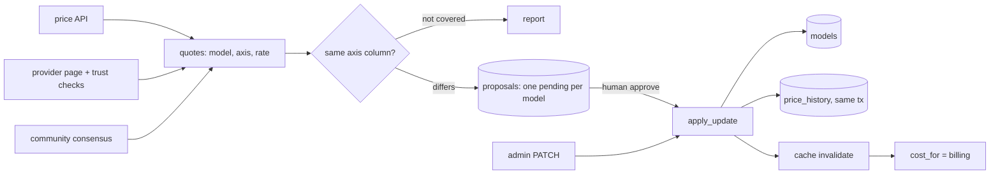

# model-price-registry

Model prices as audited, runtime-editable data, kept honest by provider sync that may only *propose*.

> An open-source reference implementation of model prices as audited, runtime-editable data. All names and data are fictional.

[](https://github.com/Tayyab-Bilal/model-price-registry/actions/workflows/ci.yml)

## At a glance

**What it is.** A small model price registry where prices are data you can edit while the app runs, not code you redeploy. Automated sources watch the providers, but they can only file drafts. A human approves each one.

**What is built**
- One audited write path that changes a rate and writes its history row together (`registry.py: apply_update`).
- Validation on the merged row, with omitted versus explicit null (`validation.py: validate_rates`, `PriceUpdate`).
- An approval queue with one pending draft per model, a snapshot per draft and stale approval refused (`proposals.py: file_proposal`, `approve`).
- Three sources: a price API, a provider page behind trust checks, and a community consensus (`sources/`).
- Billing axes, so a quote is only compared with the column for its own unit (`units.py: compare`).
- A sync run lock with a reaper for crashed runs, plus a dry run (`sync.py: _acquire`, `run_sync`).
- A 60 second rate cache with explicit invalidation (`registry.py: RateCache`).
- An insert-only seed and a guarded cached-rate backfill (`seed.py`, `backfill.py: backfill_cached_rates`).
- An admin HTTP API with 10 admin-only routes plus a sync trigger (`api.py: create_router`).

**What is not built or simplified**
- SQLite only. One writer at a time, and the API shares a single connection.
- The rate cache is per process, so other workers can lag by up to 60 seconds.
- The three sources read recorded fixtures, not live networks. The five community databases are five hand-written shapes.
- The sync trigger runs inline and has no schedule of its own. An outside scheduler calls it.
- Audio token and rerank per search quotes are reported as not covered, because the registry has no column for them.

**How it flows**
1. A trigger (the command line, or the HTTP route called by a scheduler) starts a sync run.
2. The run takes the lock by inserting a "running" row. A second run is refused, and an old stuck row is cleaned up first.
3. Each source returns quotes, each naming its billing axis. The page source runs its trust checks first.
4. Every quote is compared with the registry column for its own axis. Same means nothing, different means a draft, unknown means not covered.
5. A draft is filed with a snapshot of the current rates. There is at most one pending draft per model.
6. A human approves or rejects. If the rates changed since the snapshot, the approval is refused as stale.
7. An approval changes the price and writes the history row in one transaction, then drops the cache entry so billing sees it.

**Run it**
```bash
.venv/bin/pytest -q    # 70 passed, no network
```

## How each part works, one by one

### One audited write path
- **Risk / problem:** If each feature updates prices its own way, one of them will forget the history row. Then nobody can trust the audit trail, and a wrong rate cannot be traced.
- **How it works:**
  - Every price change, whether a hand edit or an approved draft, goes through one function. Nothing else is allowed to touch a rate (`registry.py: apply_update`).
  - It reads the old rates, builds the new ones, checks them, saves them and writes a before and after history row. The caller opens the transaction, so the price and the history row commit together or not at all.
  - Each row also records who made the change, the reason, and where it came from: migration, admin or sync.
  - After a hand edit the cached rate for that model is dropped, so billing sees the new price straight away (`registry.py: Registry.update_price`).
- **Tests that prove it:** `tests/test_registry.py`: `test_update_writes_history_in_same_transaction` (forces the history write to fail and checks the price did not change), `test_cache_invalidated_on_update`, `test_changing_price_changes_the_bill`, and 2 more in that file.

### Validation on the merged row
- **Risk / problem:** A small edit can look fine on its own and still break a rule once it is combined with the old values. For example, raising a cached rate above the input rate.
- **How it works:**
  - The rules run on the full result after the edit is merged into the old row, not only on the fields the request mentioned (`validation.py: validate_rates`).
  - The rules are: no negative prices, no price so small it rounds to zero when stored, a cached rate never above the input rate, and a model is billed per token or per minute but never both.
  - A reason is required, and a blank one is refused.
  - A field left out of the request means leave it alone, while an explicit null means clear it. The code tells these apart by asking which fields were actually sent (`validation.py: PriceUpdate`).
  - The same check runs when a draft is filed, so a draft that could never be approved is never created (`proposals.py: file_proposal`).
- **Tests that prove it:** `tests/test_validation.py`: `test_cached_above_input_rejected`, `test_token_and_minute_both_rejected`, `test_null_clears_omitted_keeps`, and 3 more in that file. Also `tests/test_proposals.py`: `test_invalid_draft_is_not_filed`.

### The approval queue and stale approval
- **Risk / problem:** A reviewer approves specific numbers. If someone edits the price in the meantime, approving the old draft would silently overwrite that edit.
- **How it works:**
  - Automation can only file a draft. Only an approval moves a price (`proposals.py: file_proposal`, `approve`).
  - A database rule allows one pending draft per model, so even two workers racing cannot both file one (`db.py: SCHEMA`).
  - Each draft stores a snapshot of the rates at filing time. On approval the current rates are read again, and if they differ from the snapshot the approval is refused as stale (`proposals.py: approve`).
  - Marking the draft decided and changing the price happen in one transaction. If the apply fails, the draft stays pending, and decisions are final once made.
  - A pending draft is only replaced by a stronger source. The order is consensus, then the API, then the provider page, so a noisy source cannot overwrite a better one's draft.
  - Bulk decisions run one transaction per draft, with a cap of 200 per call, so one stale draft does not roll back the others (`proposals.py: bulk_decide`).
- **Tests that prove it:** `tests/test_proposals.py`: `test_stale_approval_refused`, `test_one_pending_per_model_enforced_by_index`, `test_failed_apply_leaves_proposal_pending`, and 5 more in that file. Also `tests/test_provenance_and_backfill.py`: `test_bulk_decisions_capped_at_200`, and `tests/test_api.py`: `test_stale_proposal_is_409`.

### Trust checks on the provider page
- **Risk / problem:** A scraped pricing page can change layout without warning. A parser that reads the wrong column would then file confident but wrong prices.
- **How it works:**
  - Before any price is used, the page must pass three checks. It needs at least five models, no price above 500 dollars per million tokens, and it must cover at least a quarter of the models in the registry (`sources/page_source.py: from_html`).
  - If any check fails, the whole page is thrown away and the reason goes in the report. A single cell that is not a number also rejects the page.
  - A rejected page produces no quotes, so it cannot file a draft. Even a page that passes can only file drafts, never change a price.
- **Tests that prove it:** `tests/test_sources.py`: `test_page_trust_checks_block_low_coverage`, `test_page_trust_checks_block_too_few_models_and_implausible_prices`. Also `tests/test_sync.py`: `test_good_provider_page_files_a_draft_from_the_page`.

### Community consensus, or nothing
- **Risk / problem:** Community price lists copy each other. Two stale copies of an old price can outvote one correct source if you just take the majority.
- **How it works:**
  - Five community databases, each with a different shape, are first turned into the same simple form: model, axis and rate (`sources/consensus_source.py: NORMALISERS`).
  - A rate is believed only when at least two databases state exactly the same number and none disagrees. Otherwise nothing is proposed (`sources/consensus_source.py: from_payloads`).
  - A source quoting in a unit that cannot be mapped to an axis is skipped, not guessed.
  - A consensus draft is the weakest kind, so it never replaces a provider page draft.
- **Tests that prove it:** `tests/test_sources.py`: `test_consensus_needs_two_exact`, `test_consensus_disagreement_proposes_nothing`. Also `tests/test_traps.py`: `test_consensus_never_overrides_a_provider_page_draft`, and `tests/test_proposals.py`: `test_weaker_source_does_not_replace_stronger_draft`.

### Billing axes
- **Risk / problem:** Providers quote in different units: per token, per second, per minute, per search. Comparing the wrong pair gives a price that is off by 8 times, 60 times or tens of thousands of times, and it looks plausible.
- **How it works:**
  - Every quote says which axis it is on. A fixed table maps each axis to one registry column, and the unit conversion is done there once (`units.py: AXES`).
  - A quote is only compared with the column on its own axis. A per second quote is multiplied by 60 to match the per minute column.
  - An axis with no column, such as audio tokens or rerank per search, or a model that is not billed on that column, comes back as not covered. It is reported but never becomes a draft (`units.py: compare`).
  - A source quoting cents per token is converted to dollars once, and stays on its audio axis (`sources/consensus_source.py: _e`).
- **Tests that prove it:** `tests/test_traps.py`: `test_realtime_audio_rate_is_not_mistaken_for_the_text_rate`, `test_realtime_audio_never_becomes_a_draft`, `test_rerank_per_search_is_never_compared_with_a_per_token_column`, `test_cents_per_token_audio_quote_is_converted_and_stays_on_the_audio_axis`, `test_per_second_quote_misread_as_per_minute_is_off_by_60`, and 1 more in that file. Also `tests/test_sources.py`: `test_per_second_vs_per_minute_not_confused`.

### Sync run lock and reaper
- **Risk / problem:** Two sync runs at once would file duplicate or conflicting drafts. But a run that crashed and left its lock behind would block every later run forever.
- **How it works:**
  - The lock is a row in the run table with status running. A new run first checks for one, and refuses to start if it finds a live one (`sync.py: _acquire`).
  - Before checking, it marks any running row older than 30 minutes as failed, so a crashed run cannot block things forever. The check and the insert happen in one transaction.
  - If any source blows up, the run is marked failed and the report carries the error. The command line then exits non zero, so a scheduler can alert on it (`sync.py: run_sync`, `exit_code`).
  - A dry run takes no lock, opens the database read only and writes nothing. It only prints what it would file.
- **Tests that prove it:** `tests/test_sync.py`: `test_running_row_blocks_second_run`, `test_stale_run_reaped`, `test_dry_run_leaves_db_untouched`, and 5 more in that file. Also `tests/test_api.py`: `test_trigger_is_409_while_a_live_run_holds_the_lock`.

## The problem

Every AI charge in a workspace app is computed from one model price table. Changing a price meant a
migration, a review and a deploy. Meanwhile providers change prices without notice, and a wrong rate
is invisible from inside the system: every charge computed from it is self-consistent, so nothing
errors and nothing fails reconciliation. The only way to find out is to ask the provider.

This repo makes prices data, not code. They are editable at runtime through one audited write path.
Automated sources watch the providers, but they can only file *drafts*; a human approves each one.
A misread page that writes through is a wrong charge nobody sees. A misread page that files a draft
is a line item somebody rejects.

## What it does

The section above, "How each part works, one by one", explains the main mechanisms in plain English. This list is the short version.

- **One audited write path.** `apply_update` (`registry.py`) is the only code that changes a rate. A
  `PATCH` route and every approval go through it; each change writes a before/after history row in
  the same transaction.
- **Validation on the merged row** (`validation.py`): no negatives, nothing that rounds to zero, cached
  never above input, never per token and per minute together, a reason is required. Omitted field =
  leave alone, explicit `null` = clear (`model_fields_set`).
- **Provenance per row** (`migration`, `admin`, `sync`) and a CI-style check (`checks.py`) that is exact
  for migration rows and invariant-only for runtime-edited rows.
- **Approval queue** (`proposals.py`): one pending draft per model (partial unique index), rates
  snapshotted per draft, stale approval refused, decisions final, bulk decisions capped at 200.
- **Three sources** (`sources/`): an OpenRouter-style API, a provider pricing page behind three trust
  checks, and a consensus of five community price shapes.
- **Billing axes** (`units.py`): every quote names its axis and is compared only with the column that
  holds that axis; unknown axes are reported as *not covered*.
- **Sync run lock and reaper**, dry run, shared exit code (`sync.py`).
- **Admin and trigger HTTP API** (`api.py`): 10 admin-only routes plus a sync trigger.
- **Insert-only seed** (`seed.py`) and a **guarded cached-rate backfill** (`backfill.py`).
- **Rate cache** with a 60 s TTL and explicit invalidation (`registry.py`).

## Quickstart

```bash
uv venv .venv && uv pip install -e ".[dev]"
.venv/bin/python examples/demo.py                                  # the whole story
.venv/bin/pytest -q                                                # tests, no network
.venv/bin/python -m model_price_registry.sync --db r.db --dry-run  # report only
```

The CLI creates and seeds `r.db` if it does not exist, then reads it read-only for the dry run.
Sources read recorded fixtures in `tests/fixtures/` (no network); model names are invented.

Excerpt of the demo output:

```text
2b. the page layout is fixed: same sync, now with the full provider page
sync report
  proposed     acme-chat-small    from provider_page [filed]
  not covered  acme-live-1        axis=audio_input_token
  not covered  acme-rerank-1      axis=rerank_search
...
4. a human approves the acme-chat-large draft
   bill is now $4.8
5. someone edits acme-code-pro by hand, then the older draft is approved
   conflict, refused: rates for acme-code-pro changed since proposal 2
```

## Usage guide

Change a price and see the bill change. This is the same `cost_for` that billing calls.

```python
from decimal import Decimal as D

from model_price_registry.db import connect
from model_price_registry.registry import Registry
from model_price_registry.seed import seed
from model_price_registry.validation import PriceUpdate

conn = connect()  # in memory; pass a file path to keep it
seed(conn)
reg = Registry(conn)
assert reg.cost_for("acme-code-pro", 1_000_000, 100_000) == D("2.8")
reg.update_price("acme-code-pro", PriceUpdate(output_per_mtok=D("9"), reason="renegotiated"), "alice")
assert reg.cost_for("acme-code-pro", 1_000_000, 100_000) == D("2.9")
assert reg.get_model("acme-code-pro").provenance == "admin"
```

File a draft and approve it. Automation would call `file_proposal`; a human calls `approve`.

```python
from model_price_registry.proposals import file_proposal, approve

outcome, pid = file_proposal(reg, "acme-chat-small", {"input_per_mtok": D("0.30")}, "api")
assert outcome == "filed"
approve(reg, pid, "bob")
assert reg.get_model("acme-chat-small").rates["input_per_mtok"] == D("0.3")
```

Run a dry-run sync over the recorded fixtures. More in [docs/usage.md](docs/usage.md), and the HTTP
routes in [docs/api.md](docs/api.md).

```python
from datetime import UTC, datetime

from model_price_registry.sources.fixtures import fixture_sources
from model_price_registry.sync import run_sync

ids = {r["model_id"] for r in conn.execute("SELECT model_id FROM models")}
report = run_sync(reg, fixture_sources("tests/fixtures", ids), datetime.now(UTC), dry_run=True)
assert report.dry_run and report.proposed
```

## How it works



1. A trigger (the CLI, or `POST /admin/sync/trigger` called by an outside scheduler) calls `run_sync`.
   The `sync_runs` row is the lock; a stale `running` row is reaped, a live one gives 409.
2. Each source returns quotes. The page source first applies its trust checks; the consensus source
   keeps a rate only where two or more databases state it exactly.
3. Each quote is compared with the registry column on its own axis. Same: nothing. Different: a
   draft. Unknown axis: reported as not covered.
4. `file_proposal` snapshots the current rates and files the draft (one pending per model).
5. A human approves or rejects. Approval re-reads the rates; if they differ from the snapshot it
   raises `StaleProposal` (HTTP 409). Otherwise decision and price change commit in one transaction,
   a history row is written, and the rate cache entry is dropped.

## Design decisions

1. **One audited write path.** Everything that changes a rate calls `apply_update`. *Rejected:* a
   direct `UPDATE` in each feature; one forgotten history row makes the audit trail untrustworthy.
2. **Nothing automated moves money.** Sources file drafts only. *Rejected:* auto-apply under a
   threshold; a misread page then becomes a wrong charge nobody sees.
3. **Validate the merged row, not just the touched fields.** A partial update can pass on its own and
   still break an invariant. This also stops an unapprovable draft being filed. *Rejected:* checking
   only the fields in the request.
4. **Integer micro-dollars.** Equality (snapshot checks, "did it change?") is exact. *Rejected:*
   floats (drift) and decimal text (string compare is not numeric compare).
5. **One pending draft per model via a partial unique index.** The database refuses a second one even
   if two workers race. *Rejected:* an application-level check-then-insert.
6. **Snapshot per draft; stale approval is 409.** The reviewer approved specific numbers. *Rejected:*
   applying the draft over whatever is there now, which silently overwrites a hand edit.
7. **Record and apply in one transaction.** A failed apply leaves the proposal pending; there is no
   window where a concurrent hand edit is overwritten. *Rejected:* mark decided, then apply.
8. **Bulk = one transaction per proposal, max 200.** One stale draft must not roll back the others.
   *Rejected:* all-or-nothing bulk.
9. **Provenance rule.** Migration rows must match the published list exactly; admin and sync rows are
   exempt from that exact comparison (they have legitimately moved) but never from the invariants.
   *Rejected:* exempting them from everything, or from nothing (CI would fail every price edit).
10. **Source ranking.** Consensus never overrides a provider-page draft.
    Placing the API between them (consensus < api < page) is this repo's own choice. *Rejected:*
    last writer wins.
11. **Consensus or nothing.** At least two exact matches and no disagreement. *Rejected:* median or
    majority; two stale copies of the same old price can outvote one correct source.
12. **Billing axes.** Every quote carries an axis; unknown means *not covered*, never a guess. See the
    traps below. *Rejected:* "most common price".
13. **Insert-only seed.** A naive startup seed rewrites rates on every start, undoing
    runtime changes. `ON CONFLICT DO NOTHING` makes a restart a no-op for existing rows.
14. **Backfill downgrade is a no-op.** Undoing it would restore the cached-token overcharge.
15. **Drafts, not writes, for the API source.** An OpenRouter-style price API quotes the default route for a model. A
    routing change can look like a price doubling; review catches that.
16. **Run row is the lock, soft limit below the reaper.** A healthy run must never be reaped.

Units and axis traps, each covered by a test with a fixture shaped like the real quote:

- **Realtime text vs audio:** a realtime model has two input rates, audio 8x the text one in the
  fixture. A "most common price" would propose 8x. The audio quote has no registry column: not covered.
- **Per second vs per minute:** a speech model priced per minute; a per-second quote converts by 60.
  A per-minute number mistaken for per-second is exactly 60x off in this data.
- **Rerank per search vs per token:** a per-search price compared with a per-token column is off by
  orders of magnitude (40,000x in the fixture). Not covered.
- **Cents per token on an audio model:** one source quotes cents; it is converted to dollars once and
  stays on the audio axis, never landing on a per-minute or text column.

## Testing

```bash
.venv/bin/pytest -q    # no network, about 2 s
```

| Invariant | Test |
|---|---|
| History row commits with the price, or neither does | `test_update_writes_history_in_same_transaction` |
| Cache is invalidated on write and expires at the TTL | `test_cache_invalidated_on_update`, `test_cache_expires_after_ttl` |
| Another worker lags by at most the TTL | `test_two_workers_see_a_change_within_the_ttl` |
| Price change changes the bill | `test_changing_price_changes_the_bill` |
| Validation set, omitted vs null | `tests/test_validation.py` |
| One pending per model, by index | `test_one_pending_per_model_enforced_by_index` |
| Stale approval refused, decisions final | `test_stale_approval_refused`, `test_decision_is_final` |
| Failed apply leaves proposal pending | `test_failed_apply_leaves_proposal_pending` |
| One stale draft does not roll back a bulk call | `test_bulk_one_stale_does_not_roll_back_others` |
| Bulk capped at 200 | `test_bulk_decisions_capped_at_200`, `test_bulk_over_200_is_422` |
| Consensus never overrides a page draft | `test_consensus_never_overrides_a_provider_page_draft` |
| Page trust checks | `test_page_trust_checks_*` |
| Consensus needs two exact matches | `test_consensus_needs_two_exact`, `test_consensus_disagreement_proposes_nothing` |
| Axis traps | `tests/test_traps.py` |
| Run row is the lock, stale run reaped | `test_running_row_blocks_second_run`, `test_stale_run_reaped` |
| Dry run writes nothing; CLI on a fresh path | `test_dry_run_leaves_db_untouched`, `test_dry_run_cli_on_a_fresh_path_creates_and_seeds` |
| Seed never overwrites runtime rows | `test_seed_never_overwrites_admin_rows` |
| Provenance rule | `test_runtime_edited_rows_are_exempt_from_exact_check`, `test_runtime_edited_rows_are_still_held_to_invariants` |
| Backfill guarded, downgrade no-op | `test_backfill_is_guarded`, `test_backfill_downgrade_is_a_no_op` |
| All 11 routes admin-only; 409 and 422 mapping | `tests/test_api.py` |
| Docs snippets run | `tests/test_docs.py` |

## Limits & known trade-offs

- `BEGIN IMMEDIATE` serialises all writers; Postgres would lock only the model row.
- The rate cache is per process: other workers lag up to the TTL (60 s).
- Rates round half-up at 6 decimals; anything smaller is rejected, not stored.
- The API shares one SQLite connection on the event-loop thread. Use a pool for real traffic.
- `POST /admin/sync/trigger` runs the sync inline; a real deployment would hand it to a task runner.
- The sync trigger has no schedule: an outside scheduler calls it (one scheduler, not two).
- Dependencies: `pydantic>=2` is the only runtime dependency. `fastapi` (extra `api`) is needed only
  for `api.py`; `httpx` and `pytest` are used by the tests.
- Audio-token and rerank-per-search quotes are reported as not covered; the registry has no column
  to compare them with, so they never become drafts.

## Project layout

```text
src/model_price_registry/
  db.py            schema, connection, transactions, money helpers
  validation.py    invariants and PriceUpdate (omitted vs null)
  registry.py      apply_update (the write path), Registry, RateCache, cost_for
  proposals.py     approval queue, source ranking, bulk decisions
  sync.py          run lock, reaper, report, dry-run CLI
  units.py         billing axes and quote comparison
  sources/         api, provider page, community consensus, fixture wiring
  seed.py          insert-only startup seed
  backfill.py      guarded cached-rate backfill
  checks.py        CI-style provenance-aware rate check
  api.py           FastAPI admin and trigger router
tests/             one file per area, fixtures in tests/fixtures
examples/demo.py   end-to-end walkthrough
docs/              usage.md, api.md
```
